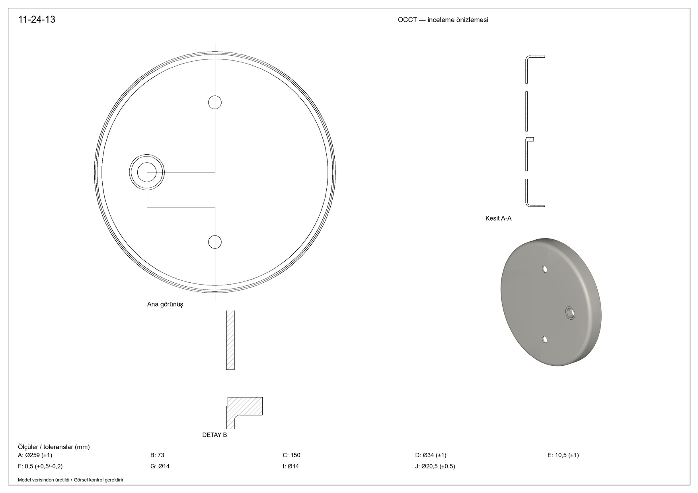
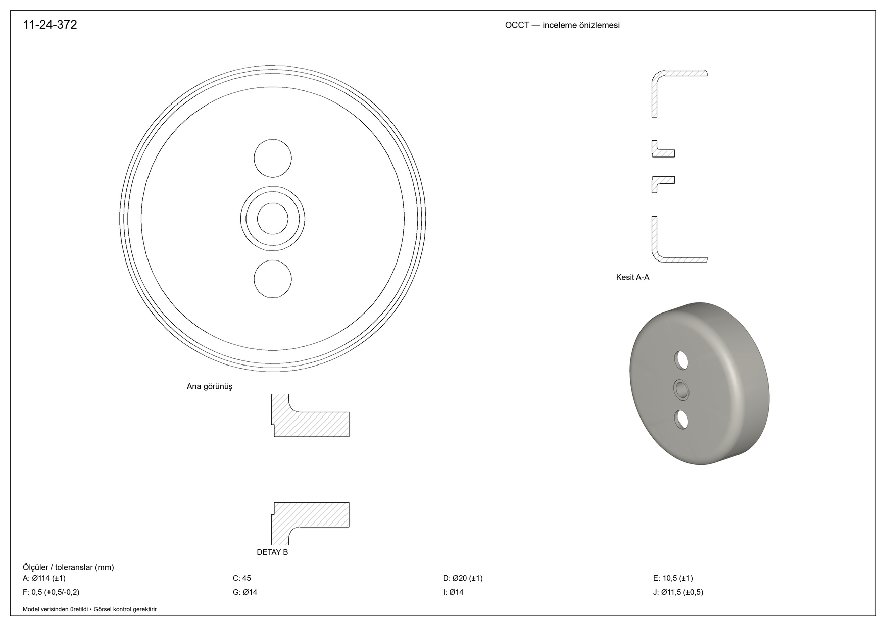

# Gemini high + açık axis/tangent seçicisi

[Üç JPEG topluca](contact.jpg) · [JPEG ZIP](taslak4-high-3-jpeg.zip)

Kullanıcı talimatıyla kenar yönü sözleşmesi directionKind=axis|tangent olarak netleştirildi ve reasoning high yapıldı. Model google/gemini-4-argon; API model alanı da aynı. Taslak4.jpg/xlsx önceki testlerle SHA256 olarak aynı; source-comparison.json içinde. F'nin içeri çökme yönü veya parçaya özel ek açıklama modele gönderilmedi. Tek yeni API çağrısı. Geometri tarifi elle değiştirilmedi, otomatik tekrar değerlendirme yok.

## Kod değişikliği

axis daire/elipsin dönme eksenidir; tangent near noktadaki kenar teğetidir. Native yürütücü bu türleri ayrı doğrular. Eski v7 kayıtlarında tür eksikse eski tangent anlamı korunur. Dairesel axis seçiminde silindirin düz dikiş çizgisi aday olmaz. Gerçek farklı eşit yakın adaylar hâlâ reddedilir. Birim/yön kontrolleri gevşetilmedi. 77 C# ve12 native test geçti; döndürülmüş bazda axis, axis/tangent aynı dairesel kenarı seçme ve yanlış türü sessizce yeniden yorumlamama dahil.

## Sonuç

Üç ürün için native katı ve JPEG üretildi. R8, R5, R1.5 ve R2 fillet işlemleri geçerli BRep üretti. Tek pozitif hacimli final solid, deliklerin malzeme kaldırması, STEP yeniden açma ve hacim tutarlılığı geçti. Detay B, modelin verdiği section_AA kaynağından ve [0.29,0.63,0.12,0.24] sayfa kutusunda büyütülerek üretildi. Kaynak geometri tekrar modellenmedi. Ölçü tablosu detayın altında taşınca yalnız yerel tablo aralığı/sütun sayısı sıkıştırıldı; API yanıtı/geometri değiştirilmedi, yeni API çağrısı yapılmadı.

- G/I delikleri y=±C/2. Manşon x=−B ve B0 üründe merkezde.
- Bu kez F0.5, z0'dan+F'e malzeme kesen cyl_recess_F/cut_recess_F ile tarif edilmiş; dışarı taşma yerine içeri kesme var.
- Recess çapını model (D+J)/2 seçmiş. Bu ölçü taslakta bağımsız verilmemiş; yorumun imalat geometrisine uygunluğuna kullanıcı bakmalı.
- Manşon başlangıcı sac arka yüzü z3, uzunluğu E; bu nedenle ucu z3+E. Önceki high modelinin E yorumundan farklıdır. E ölçüsünün hangi iki yüz arasında olduğu insan incelemesine tabidir.
- R1.5 yalnız dış ağız kenarına uygulanmış; taslaktaki ağız ucunun tüm yuvarlak profiliyle eşit olduğunu yalnız native işlemin geçmesi kanıtlamaz.

## Kalan sorunlar

1. B/G/I taslakta yeşil; model bu ölçülerde sourceColor atlamış ve yerel black varsayılanıyla görünür olmuşlar. Siyah R2'yi tersine green döndürmüş, bu yüzden R2 yazısı gizleniyor. Yerel renk kuralı uygulanmış ama modele ait renk sınıflandırması yanlış.
2. İlk iki üründe main=cyl_outer gövde ekseni ile manşon ekseni aynı Y seviyesinde. Yerel iz her ikisinin referans noktasını ziyaret ediyor, yatay geçiş manşon merkez seviyesine düşüyor. Böylece kesit/detailde manşonun bir yarısı beklenen biçimde gösterilmiyor. Referans merkezlerinin sonlu izde olması gerekli ama eksen etrafındaki kesit parçasının tümünü doğru göstermek için yeterli değil. Bu yerel yol/ana referans semantiği eksikliği, tarif veya giriş elle onarılarak gizlenmedi.
3. Antet, tam ölçü oku yerleşimi ve eksen çizgileri hâlâ inceleme önizlemesi düzeyinde. Bu resimler üretim paftası değildir; Detay B'nin doğru konumda çıkması onun bütün geometri yorumunun doğru olduğunu göstermez.

## Kullanım

|Metrik|Önceki Gemini medium isteği|Yeni Gemini high isteği|
|---|---:|---:|
|Giriş|3936|3956|
|Bildirilmiş akıl yürütme|0|15328|
|Görünür çıktı|2406|2557|
|Toplam çıktı|2406|17885|
|Maliyet USD|0.031932|0.186762|

Cache0. Görünür veri benzer büyüklükte; artış esas olarak bildirilen akıl yürütmede. High ve seçici sözleşmesi birlikte değişti; iyileşmenin paylarını tek çağrıyla ayıramayız. Native çizim/yeniden yerleşim için ek API maliyeti yok. Özel akıl yürütme yayımlanmadı. Tarif onaylı üretim kaydı olarak işaretlenmedi.

## Görseller

