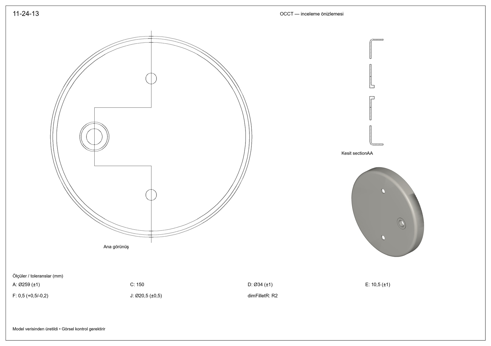
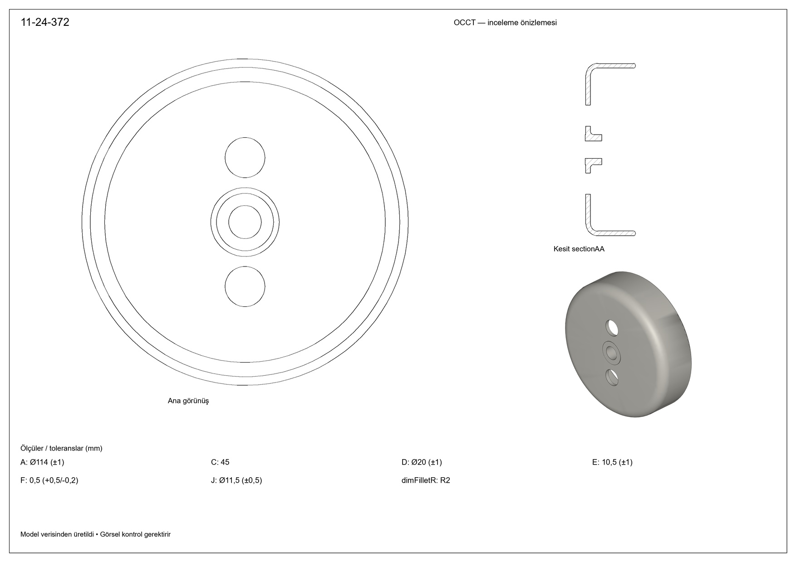

# Taslak4 — yeni parça denemesi

[Üç görsel topluca](contact.jpg) · [JPEG ZIP](taslak4-3-jpeg.zip)

Kullanıcının taslak4.rar arşivi güvenli yollarla açıldı: taslak4.jpg (7016×4961,300DPI) ve taslak4.xlsx (3 satır). Arşivdeki imalat notları çizim verisi olarak ele alındı. Mevcut yazılım/prompt/sözleşme/yürütücü değiştirilmeden çalıştırıldı; modele asistanın hazırladığı ek geometri açıklaması gönderilmedi.

Tek yeni API çağrısı; high, tek JPEG ve tek ayrıştırılmış tablo. Ardından render-saved-group ile kayıtlı yanıt yerelde çözümlenip çizdirildi. Modelin ham recipe.json yanıtı değiştirilmedi. Aday tarif saklandı; insan/üretim onayı verilmedi. Genel antet/ölçü yerleşimi geliştirmelerine girilmedi.

## Modelin tarifi

- A dış çap;3mm sac,33mm derinlik, dışR8/içR5 köşe, R1.5 yuvarlak ağız ucu: doğru/yay profili Z çevresinde360° döndürülüyor.
- G/I üst-alt delikler x0, y=±C/2. Model simetrik konumlandırmış; çizimde farklı bir kaçıklık verilmemiş.
- Manşon merkezinin x'i −B, y0. D dış çap, J iç delik; manşon z=−F'ten +E'ye uzanıyor. Bu yüzden toplam silindir uzunluğunu E+F almış. R2 manşon ile sacın arka yüzündeki birleşim kenarına uygulanmış. Bu yorumun imalat taslağıyla uygunluğu kullanıcı görsel kontrolüne tabidir.
- Yeşil B/G/I ve sabit3/33/R8/R1.5 geometride kullanılıyor, yerel ölçü katmanında gizleniyor. Siyah A/C/D/E/F/J ve sabitR2 mevcut önizlemede tabloda gösteriliyor. 33 ölçüsünün yeşil ±0.5 toleransı geometri nominalini değiştirmiyor; çıktıdaki toleranslı yazdırma için kullanılmıyor.
- Model main=holeG, through=holeI/holeJ referanslarını verdi. Manşonun kaçık olduğu ilk iki satır kademeli, B0 olan üçüncü satır düz kesite dönüştü. Merkezdeki manşon/delik kaldırılmadı.

|Ürün|A|Üst/alt y|Manşon x|D dış çap|J iç çap|Manşon z aralığı|Kesit|
|---|---:|---:|---:|---:|---:|---|---|
|11-24-13|259|±75|−73|34|20.5|−0.5…10.5|Kademeli|
|11-24-216|160|±44.5|−44.5|19|11.5|−0.5…9|Kademeli|
|11-24-372|114|±22.5|0|20|11.5|−0.5…10.5|Düz|

## Doğrulama

Üç satırın birim/parametre/kesit kontrolü geçti. Üç katı geçerli, pozitif hacimli ve tek final solid. Delikler malzeme kaldırdı. STEP yeniden açma ve hacim eşitliği geçti. native-results.json her OCCT işleminin denetimini içeriyor. Görseller açılarak incelendi. Deneme yeni native işlem/ürüne özel düzeltme gerektirmedi.

Bu kontroller taslağın eksiksiz doğru yorumlandığını veya imalat uygunluğunu kanıtlamaz. Özellikle modelin +Z ana görünüşü açık tarafa bakıyor; taslaktaki kapalı ön yüz görünüşünden farklı iç halkalar çıkıyor. Kamera düzeltmesi yapılmadı. İzometri de modelin seçtiği kamerayla üretildi.

## Sınırlar

Model Detay B'deki geometriyi ana katıya taşıdı; sözleşmede ayrı detay/zoom görünüşü döndürmedi. Önizleme yürütücüsü de henüz detay penceresi üretmiyor. Antet, yerleşim, oklarla ölçülendirme ve eksen çizgileri önceki önizleme düzeyinde; bu turda geliştirilmedi. Gerçek geometri/görünüş/kesit + ölçü tablosu içeren JPEG'lerdir, bitmiş imalat paftası değildir.

## Kullanım

Giriş9213, akıl yürütme9858, görünür çıktı4163, toplam çıktı14021. Maliyet **0.158636 USD**, cache0. Yerel çözümleme ve üç JPEG için ek API çağrısı/maliyeti yok. Tek çağrıda muhakemenin ne kadarı detay/yarıçap/kesite harcandı ayrı ölçülemiyor. Ham özel akıl yürütme yayımlanmadı.

## Görseller

