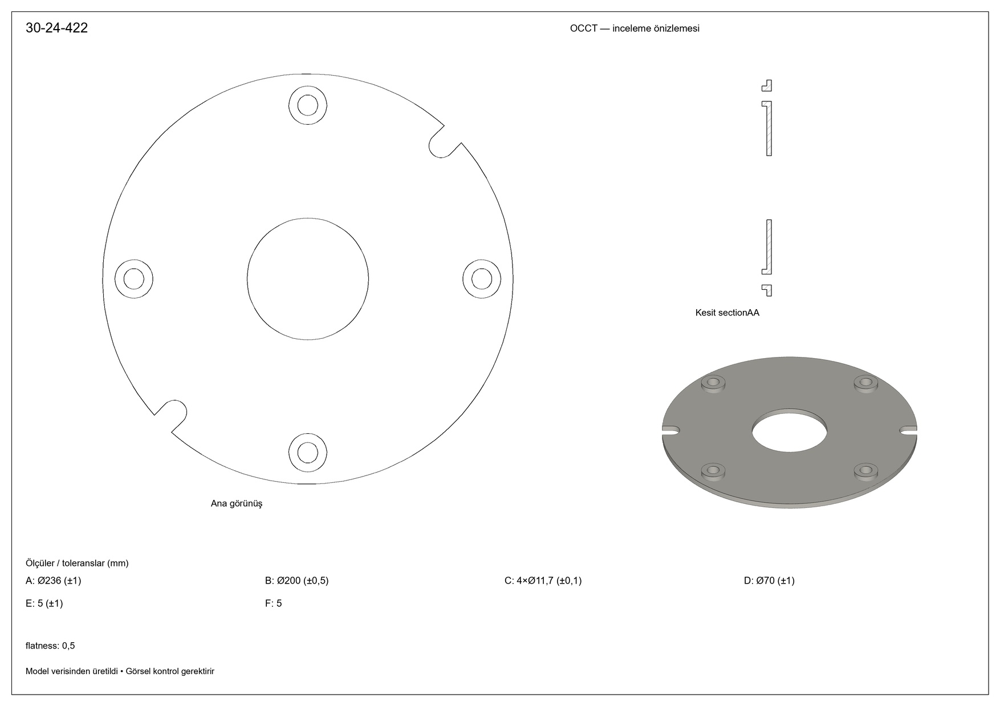
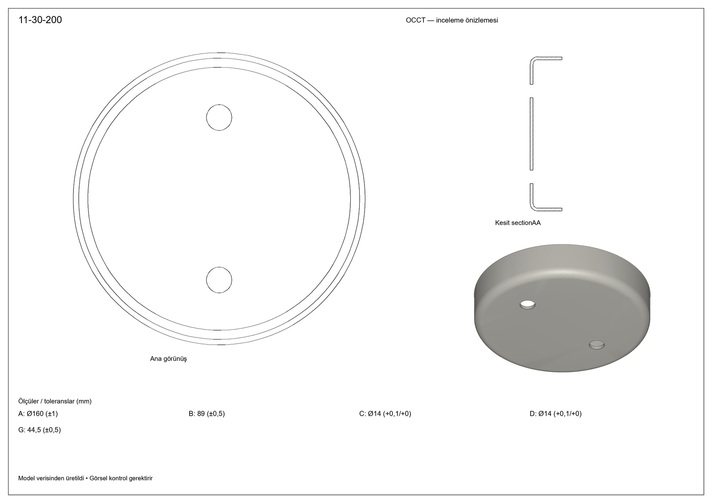
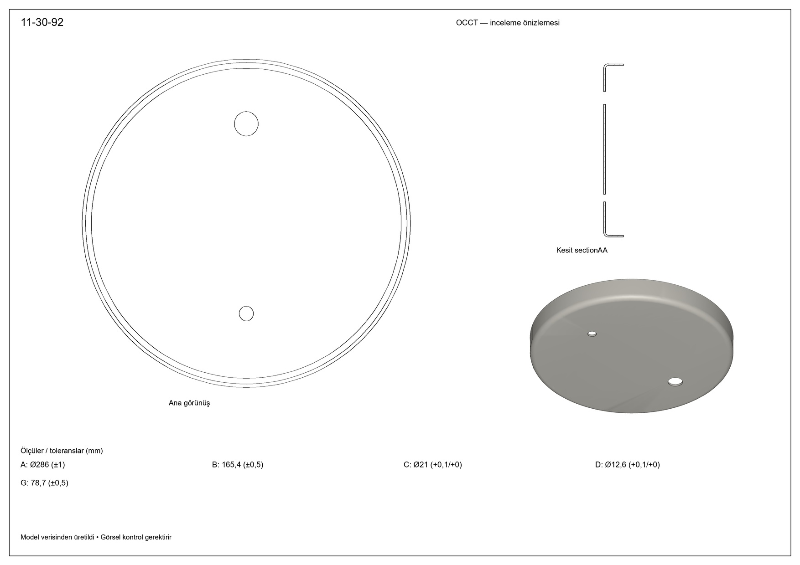
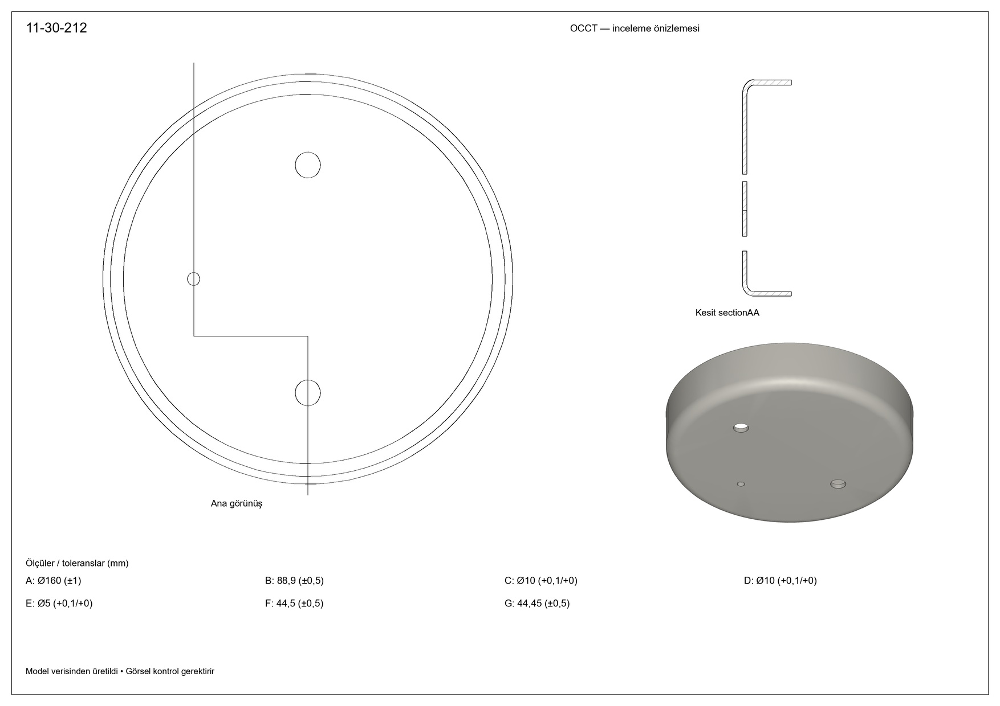

# Yeni sözleşmeden gerçek OCCT önizlemeleri

Son iki kayıtlı API tarifinden kapak3 + taslak2 dört ürün üretildi. Ek olarak212'nin eski hatalı çözümlenmiş kesiti ayrı old-212 klasöründe çizdirildi. **Yeni API çağrısı0.** Ham API/recipe kayıtları değiştirilmedi. Güncel yedi önizleme, mevcut düzeltmeli yerel çözümleyiciyle; eski212 karşılaştırması saklanan eski resolved JSON ile üretildi.

[JPEG ZIP](jpeg-previews.zip) · [Toplu görünüm](contact.jpg)

## Uygulama

Yeni tools/cad_recipe_executor.py çözümlenmiş v7 JSON'u okuyup OCCT işlemlerini çalıştırıyor; eski pleyt geometri kurucusu çağrılmıyor. Legacy worker'dan yalnız mesh görüntüleme, technical_sheet'ten genel kenar örnekleme/kapalı tel yardımcıları kullanılıyor. Parametreler/model ailesi dönüştürülerek eski tarife zorlanmadı.

Desteklenen işlemler: circle/polyline/line+arc/roundedSlot profili, extrude/revolve/cylinder, boolean cut/fuse(join), throughAll veya derinlikli hole, circular/linearPattern, geometrik near+direction ile fillet/chamfer. Örtüşen/iç içe sketch döngüleri açık cut gerektirir; otomatik yanlış yorumlanmaz. Chamfer dahil tüm sözlük örnekleri bu veri setinde sınanmış değildir. Desteklenmeyen işlemler hata verir.

Modelin kameraları korundu. Özellikle taslak2 ana görünüş +Z, katının açık tarafına bakıyor; bu yüzden taslak JPEG'den farklı iç çeper halkaları görünüyor. Bu veri kamerayla ilgili inceleme bulgusudur, yürütücüde kamerayı ters çevirerek gizlenmedi. İzometri de modelin direction/up değerleriyle üretildi.

Kenar seçiminde OCCT aynı kenarı birden fazla yüz üzerinden döndürdüğü için IsSame ile tekilleştirme yapıldı. Kesit, tarifteki gerçek düzlem veya sonlu bandlardan OCCT section ile türetildi. Kesit connector yüzleri paftaya ayrı kesit olarak taşınmıyor; band dikişleri kalabilir.

## Doğrulama

Yedi ürün ve eski212'de katı geçerliliği, pozitif hacim/tek final solid, delik kesmesinin malzeme kaldırması ve STEP yeniden okuma/hacim eşitliği geçti. Native ayrıntılar her klasörde native-results.json. 71 C# kontrolü +4 native test geçti (bilinen delik hacmi, ötelenmiş baz, boşa delen deliğin reddi, bilinmeyen işlemin reddi). Görsel olarak yedi ürünün kontakt sayfası ve212/kapak örnekleri açıldı.

## Sınırlar

Bunlar **inceleme önizlemeleri**, tamamlanmış imalat paftaları değil. Ana görünüş/kesit/izometri gerçek katıdan üretiliyor. Ölçü-toleranslar kaynak Excel bağlantısından Arial ile tabloda gösteriliyor; henüz ilgili kenarların yanında ok/ölçü çizgileriyle yerleştirilmiyor. Geometrik toleransın değeri tabloda; yüzüne bağlı çerçeve/ok yerleşimi eksik. Orijinal antet, ölçü çakışma çözümü, gerçek kağıt ölçeği ve kesitte geride kalan görünür kenarlar henüz uygulanmadı. JPEG1754×1240, DPI kaynaktan korunuyor. Bu önizlemeler üretim onayı değildir.

C# komutu: `render-saved-group <xlsx> <jpeg> <saved-api-run> <empty-output>`. Kaynak hash denetimi/yerel çözümleme yapar, anahtarı süreç ortamından çıkartarak native yürütücüyü başlatır. Native sonuçlar ayrı render-report.json içinde; analiz raporu görüntü ürettiğini iddia edecek biçimde yeniden yazılmadı. Bu komut genel run-cad-group akışındaki pafta eksiğini tamamlanmış saymaz.

## Görseller

### 30-24-143

### 30-24-422

### 30-24-54

### 11-30-200

### 11-30-212

### 11-30-381

### 11-30-92

### 11-30-212 — eski kesit

